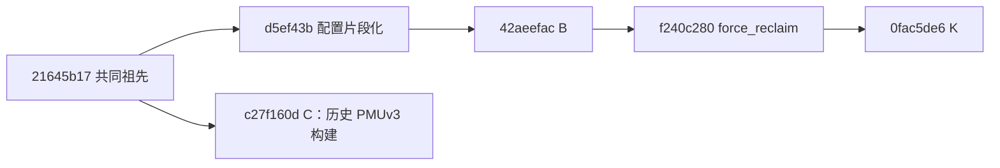

# 内核 AutoFDO K0 可行性评估

日期：2026-11-17（America/Los_Angeles）。范围：主机源码、历史构建记录与既有 perf 文本；**没有构建、没有接板、没有生成 profile、没有修改 LLVM/内核产品代码**。能力增强方案 v0.1 保持原文，本报告为 Codex 的事实核查与评审意见，不代表 Kimi 已评审或方案已冻结。

## 1. 结论与边界

**Conditional go：K0 的源码可行性、精确基线核对和回移植适用性检查已完成；实现、构建与运行验收仍属于 K1。** 建议先做 ARM32/A32、非 LTO、非 MFS 的 vmlinux IP AutoFDO；arm64 为第二平台。必要条件是适配冲突项及 MFS 门禁、实现 profgen 内核 IP 模式、取得与采样匹配的 vmlinux/DWARF，并完成启动、正确性及配对性能/尺寸验证。K1 仍须等 M1 完成、owner 确认方案和基准，刷写另须用户确认。不能把 x86 分支采样收益外推为本项目收益，也不能承诺 IP-only 一定更快或更省内存。

关键裁定：

- 已保存的 RPi4 PMUv3 构建配置为 **A32 内核、DWARF4、LTO_NONE**；C 与当前指定 K 的源码关系现已核实为分叉，不能把这份历史 .config 当作 K 新构建的实测结果。用户态 FFmpeg Thumb 的经验不等于 Thumb 内核已经验证。
- LLVM 22.1.8 的 `-fsplit-machine-functions` 和有效 basic-block sections 不支持 ARM32。直接照搬上游带 profile 的 AutoFDO 标志会失败；必须让 MFS 按目标能力启用。ARM32 ThinLTO 也没有内核 Kconfig 支持，不能靠加一个 select 宣称可用。
- AutoFDO 不要求插桩运行时。A4 的 kernel/pgo 和 sampled instrumentation 是另一项研究，**不作为 K1 前置条件**；默认 TLS 采样计数器、LLVM profile ABI、noinstr/中断/并发路径都需要适配。
- `BR_RETIRED`/`PC_WRITE_RETIRED` 的事件采样仍是带 skid 的普通 IP 样本，事件计数存在不证明样本 PC 是被采分支的目标。A2 目前是待验证假设；不能按块首归类后就称为真实边频率。
- resourced 很适合提供内存压力场景；其策略改变带来的回收、压缩、冻结和杀进程收益须与编译优化分开。用户态 resourced 本身是否值得 AutoFDO，要先看 CPU 热度与可重复触发方式。

### 1.1 输入身份与引用约定

用户给定两个提交是基线事实，优先于主机旧源码：

| 代号 | 仓库/版本 | 本机只读分析位置 |
|---|---|---|
| K（已取得） | `platform/kernel/linux-rpi@0fac5de6a63091d141ad1cd3ed9d9e92b8dde708` | `temp/kernel-afdo-k0/linux-rpi-board`；独立检查 worktree 为 `backport-k-check` |
| B（辅助参考） | 本地 linux-rpi `42aeefac58edeb081aff440f0b60be71cbe49755` | `src/linux-rpi`；独立检查用 `temp/kernel-afdo-k0/backport-reference-check` |
| C（历史构建） | PMUv3 `c27f160de761bb55f64672ceac642698a6e93684` | `temp/linux-rpi-pmuv3` |
| R | `platform/core/system/resourced@94d346c306233803661e8eab8557596549d82be4` | `temp/kernel-afdo-k0/resourced` |
| L | LLVM 22.1.8，`f999bd406c0a70fe8107aa992164fe6945c5d46a` | `src/llvm` |
| P | 发布 sandbox `c8942ae1b53099a78a97dca2b64427af6e58432b` | `temp/llvm-profgen-sandbox-verify-20261114` |
| U | 上游稳定 Linux `v7.3.5` | `temp/kernel-afdo-k0/linux-upstream` |

下文 `K:path:行` 等均为指定提交的源码位置，而不是浮动分支或试应用补丁后的文件。K 的原始源码快照从 `git show K:path` 保存；B 的历史参考结果保留在附表。**当前 6.12 源码结论以 K 为准；实际已构建配置仍来自历史 C 构建产物。** LLVM 版本由 `L:cmake/Modules/LLVMVersion.cmake:3–13` 核实。最新稳定版由 [kernel.org releases.json](https://www.kernel.org/releases.json) 于首轮 2026-11-17 查询确认：7.3.5（2026-11-17），主线 7.4-rc3 不纳入稳定版清单。查询快照随证据保存；不能用旧的 6.13 文档代替 2026 年架构支持现状。

### 1.2 方案入库

用户指定的 Downloads 文件已用 `mv` 原样移入 [01_arm_profile_capability_proposal_v0.1.md](01_arm_profile_capability_proposal_v0.1.md)，移动前后 SHA-256 相同：

`be164e5f1372863abc5c0fb80046da13a1a4eb5e37201ee633ebac34869a87b3`

STATUS 新增与 workflow 并列的内核 AutoFDO 轨道；方案仍待 Kimi/Codex 联合评审闭环（本报告提供 Codex 事实核查），K1 必须等 M1 完成且刷写获得用户确认。本次没有改设计 v0.3、hq、M1 文件或工作流运行目录。

## 2. 获取结果与内核基线

### 2.0 本轮补取与精确基线

按 PM 更正规则，网络传输中断允许在同一账号下重试；本轮先从主工作区只读 B 执行 `git clone --local --no-checkout` 到任务目录，复用已有对象，再将 origin 指向 `ssh://lhmax2025@review.tizen.org:29418/platform/kernel/linux-rpi`。`ls-remote --heads` 一次成功，tizen 仍指向 B；随后直接 fetch 指定 K SHA **一次成功，传输 10 个对象（8 个 delta），重试 0 次**。开始前未检测到 GBS/rpmbuild，传输开始后没有暂停/冻结。`git cat-file -t K` 返回 commit，独立 sparse worktree detached HEAD=K，纳入所有 patch 涉及文件及本轮分析路径。[获取记录](evidence/k-acquisition.json)、[分支查询](evidence/k-ls-remote-attempt-1.stdout)、[fetch 原文](evidence/k-fetch-attempt-1.stderr)。resourced 的指定 R 提交已在上一轮取得，本轮不重新克隆。

| 比较 | 已验证关系 | 差异提交 |
|---|---|---|
| B → K | **K 是 B 的后代，领先 2 个提交**；merge-base=B | `f240c28093027707f5e09f8a9cbbed16a43ebb1a` force_reclaim 语义修正；`0fac5de6a63091d141ad1cd3ed9d9e92b8dde708` PMUv3 配置 |
| C ↔ K | **分叉**；共同祖先 `21645b17c0d913e2ba7e10fbc9c993d286b3f57d`；C 独有 1、K 独有 4 | C 独有 `c27f160de761bb55f64672ceac642698a6e93684`；K 独有 `d5ef43b342dcbcbddb464bc20deae6ced6ed7193` 配置片段化、`42aeefac58edeb081aff440f0b60be71cbe49755` Hailo v4.22，以及上列两个提交 |
| B ↔ C | 仍为分叉；共同祖先同上 | B 独有 d5ef43b / 42aeefac；C 独有 c27f160d |



K 相对 B **仅两个文件变化**：`arch/arm/configs/tizen_bcm2711_defconfig` 增加 `CONFIG_ARM_PMUV3=y`（K 第 469 行），`mm/memcontrol-v1.c` 修改主动回收行为。K 已包含 PMUv3 启用；C 有等价的配置设置，但 C 不是 K 的祖先。K/C 的 ARM32 defconfig 键值映射相同（PMUv3 行位置不同），不等于源码、最终构建配置或 ELF 相同。[完整关系与 diff](evidence/k-baseline-audit.json)、[配置与文件哈希比较](evidence/k-config-comparison.json)。

**与内存基准直接相关的增量**：`f240c280` 在 `K:mm/memcontrol-v1.c:2425–2468` 将 `memory.force_reclaim` 的旧 boolean 参数改为 `MEMCG_RECLAIM_MAY_SWAP`，使匿名页可换出；成功返回 0，拒绝超过 ULONG_MAX 的请求、跳过零请求、逐轮仅请求剩余目标，并在连续两轮无进展时停止。仍可能按回收批次超出目标，不是严格页数上限，也没有引入 proactive reclaim 语义。[原始提交 diff](evidence/k-force-reclaim.patch)。K1 的 BASE/AFDO 必须都包含此修正，不能把它相对 C/B 的内存或 swap 改善归因于 AutoFDO。

**K 的 spec/配置与 B 的逐项差异**：

| 项目 | K 的源码事实与位置 | 相对 B |
|---|---|---|
| 编译器 | `packaging/linux-rpi.spec:165–169,234–238`：存在 `_toolchain` 且 `toolchain_is clang` 时 export LLVM=1；否则不强制 clang，Kbuild 默认 gcc 仍可被环境/宏覆盖 | spec 字节相同；不能仅据 spec 断言某个已发布 RPM 用哪个编译器 |
| ARM32 配置 | spec `:4–9,187–201`：`arch/arm/configs/tizen_bcm2711_defconfig`，普通/RT 合并对应 LSM/RT fragments 后 olddefconfig | 相同；RT 也从同一基础配置继承 PMUv3，未实测 RT 构建 |
| PMUv3 | defconfig `:469` 明确 y | 唯一 defconfig 键值变化：未列出 → y |
| DWARF/BTF | defconfig `:531–532`：DWARF4=y、BTF=y；正常链接生成含调试信息的 vmlinux | 值相同，因插入 PMUv3 行，原 B 行号后移 1 |
| THUMB2_KERNEL | defconfig 未列出；`arch/arm/Kconfig:1137–1141` 仅 CPU_THUMBONLY 默认 y，普通 ARMv7 BCM2711 按默认应为 n | Kconfig 与 defconfig 该项均无变化；这是源码推断，本轮没有生成 K 的最终 .config |
| LTO/GC/KASLR | defconfig 未显式列出；ARM32 未 select Clang LTO 能力；公共/ARM Kconfig 与 B 相同 | 无变化；历史 C 的最终配置值见下表，不冒充 K 的构建结果 |
| 模块 strip | spec `:300`，`INSTALL_MOD_STRIP=1`；安装的模块不能当作完整 DWARF 输入 | 相同 |
| vmlinux/devel | spec `:302–327,365–369`，复制到 devel 包；排除 `.tmp_vmlinux*`，未排除最终 vmlinux | 相同；仍须在构建产物中检查 debug sections/build-id |
| debuginfo 拆分 | spec 没有显式 `%debug_package` / `find-debuginfo` 调用；由 RPM/GBS 宏处理。`:284` 在 perf/bpftool 安装后清理 buildroot 的 `/usr/lib/debug`，发生在后续模块/devel 安装和 RPM 自动处理前 | 相同；该清理不能直接证明最终不产 debuginfo 包，也不能保证模块 DWARF 被保留。历史 C 的 debuginfo RPM 记录不能代替 K 产物验证 |

spec SHA-256（K=B）：`03cc402251ff955763eea39a653e6cd986a9b06d85950236d3eeee958c9d30ff`。K 与 B 的 ARM/arm64 Kconfig、相关 linker scripts、PMUv3/CoreSight 文件和 RT/LSM fragments 均已逐文件比较一致。没有运行 make、olddefconfig、rpmbuild 或编译器。

**旧采样 build-id**：在 K 的 packaging、ARM defconfig、Makefile 与新增提交说明中未找到 `395733b9c917cb98309b39cc3ec379c03ac36b3f`；K 跟踪文件中也没有 vmlinux、System.map、最终 .config 或 `.build-id` 产物。K 提交说明提到以 `21645b17` 为基础的历史 PMUv3 构建，并在当时声明该新基线尚未构建/启动；这是提交时的历史描述，不推翻用户对当前板用源码的指定，也不是二进制配对凭据。[有界搜索记录](evidence/k-build-identity-search.json)。本轮没有取得匹配 ELF/构建清单，没有使用其他构建的 System.map；旧样本仍不能可靠命名 top 20 内核函数。

### 历史：首轮获取失败（1b096d2，保留）

首轮全量 SSH 克隆曾退出 128，当时按“SSH 失败停止该项”的旧规则未重试，因而报告“K 未取得、精确基线未验证”。原始日志保持不变：

```text
Cloning into 'temp/kernel-afdo-k0/linux-rpi-board'...
Connection reset by 13.124.117.121 port 29418
fetch-pack: unexpected disconnect while reading sideband packet
fatal: early EOF
fatal: fetch-pack: invalid index-pack output
```

当轮暂停过克隆进程，无法排除对连接的影响；该错误属于传输失败，并非已经证实的权限失败。本轮在 PM 允许网络重试后完成增量补取，上述历史阻塞已解除。账号始终为 lhmax2025，没有推送 Gerrit 引用。

### 2.1 已构建配置的实际值

读取 [PMUv3 构建报告](../03_pmuv3_build_result.md) 第 7、8 节所指的 `temp/pmuv3-verify/arm-rpi4/boot/kernel/devel/kernel-devel-arm-rpi4/.config`，不是重新运行 Kconfig，也不是用 defconfig 猜最终值。

| 项 | 实际结果 | `.config` 行号/说明 |
|---|---|---|
| THUMB2_KERNEL | n | 489；实际为 A32 |
| DEBUG_INFO | y | 6756 |
| DEBUG_INFO_NONE / DWARF_TOOLCHAIN_DEFAULT | n / n | 6758–6759 |
| DEBUG_INFO_DWARF4 / DWARF5 | y / n | 6760–6761 |
| DEBUG_INFO_REDUCED | n | 6762 |
| DEBUG_INFO_COMPRESSED_NONE / ZLIB | y / n | 6763–6764；ZSTD 项未出现 |
| DEBUG_INFO_SPLIT | n | 6765 |
| DEBUG_INFO_BTF / BTF_MODULES | y / y | 6766、6770；BTF 不能替代 DWARF 行表 |
| LTO_NONE | y | 650；LTO_CLANG、LTO_CLANG_THIN 未出现，不是可选且已实测关闭 |
| RANDOMIZE_BASE | 未出现 | ARM32 基线没有该能力；不能给 arm64 推导同样结论 |
| HAVE_LD_DEAD_CODE_DATA_ELIMINATION | y | 219 |
| LD_DEAD_CODE_DATA_ELIMINATION | n | 220 |
| FUNCTION_SECTIONS | 没有独立 CONFIG 项 | 构建报告 §8 保存的 `init/.main.o.cmd:1` 明确 `-fno-function-sections -fno-data-sections`；不是把“未出现”写成 Kconfig=n |

配置已经有 DWARF4，不等于已经具备 AutoFDO 所需 discriminator / profiling-friendly 行表。K1 的训练构建还要明确开启 `-fdebug-info-for-profiling`；unique internal names 是本项目建议的函数消歧选项，并保存与板上镜像匹配的 vmlinux/debug 文件。

## 3. 上游提交、回移植检查与架构适配

上游浅取成功：`v7.3.5` 指向 `988117cc1bb17338c586a4e21ade88b5397eac33`。检索覆盖两个 Makefile 的完整路径历史、arch/Kconfig 相关变更、通用 linker script 历史，以及 AutoFDO/Propeller/function-sections 关联修正。详细 **37 项（含别名、非前置项及开发线排除项）** 的完整 SHA 链接、全部改动文件、检查结果见 [逐提交清单](02_upstream_backport_inventory.md)。没有将主题分支同义提交重复算成主线新功能。

| 核心提交 | 版本 | 主要文件与作用 | K 按依赖累计检查 |
|---|---|---|---|
| `315ad8780a12` | 6.13 | 新增 scripts/Makefile.autofdo；Makefile、Makefile.lib、arch/Kconfig、x86/Kconfig、objtool、文档/维护者；基础 CONFIG_AUTOFDO_CLANG | 干净 |
| `0043ecea2399` | 6.13 | include/asm-generic/vmlinux.lds.h；先收集 unknown/unlikely，hot 页对齐并先于 TEXT_MAIN | 干净 |
| `db0b2991ae1a` | 6.13 | 同上；冷热 start/end markers | 干净 |
| `0847420f5e49` | 6.13 | 同上 + Makefile.autofdo；AFDO function sections 与 TEXT_MAIN 条件 | 干净 |
| `2fd65f7afd5a` | 6.13 | 同上 + Makefile.autofdo；MFS、.text.split 及 LTO 后端标志 | 干净；ARM32 仍须禁用 MFS |
| `d5dc95836147` | 6.13 | Makefile.propeller、Makefile.lib、arch/Kconfig、x86 select/链接脚本、通用 TEXT_MAIN、objtool、文档 | 干净；不是 K1 前置 |
| `d63b852430be` | 6.13 | Makefile.propeller；Clang 20 从 labels 改 address-map、对应 LLD 参数 | 干净 |

后续需要审阅的修正：

- **6.13 数据节改名** `bb43a59944f4`、`dbefa1f31a91`：防止 function/data sections 匹配破坏 once/unlikely；K 继承了 B 已有的稳定树等价提交，原补丁受后续上下文影响不能直接重套。
- **6.16 i915/GCOV** 主线 `a7137b1825b5`、`d02b2103a08b`；K reverse-check 干净，已包含等价改动；ARM 首版不引入 i915 配置。`686d773186bf`、`ef69f9dd1cd7` 为同义 topic 版本，不冒充主线祖先。
- **6.18 文档** `3f65aa8ede23`：typo，基础补丁后可干净应用。
- **6.19 节匹配与歧义修正** `1ba9f8979426 → 6568f14cb5ae → f6a8919d6148`：统一 TEXT_MAIN/DATA_MAIN 与模块脚本、排除 startup/exit、补短名 start 等模式。K 的 `include/asm-generic/vmlinux.lds.h` / `scripts/module.lds.S` 上下文冲突，后续依赖也未满足。`9c7dc1dd897a`、`93863f3f859a` 增加 objtool/Kbuild 歧义检查；`024020e2b6ad`、`2c2acca2eabf` 修复 cold function/同名符号处理；K 的 objtool/宏上下文冲突。六个相应函数改名补丁（xen split、atomisp startup 两处、amiserial/icom/synclink startup）在 K 上可干净应用，完整 SHA/文件见附表。
- **7.2** `a960c2cdb19e`、`7594302d9ddd` 为 Rust AutoFDO/参数改名，K 加基础后可应用但 ARM32 K1 不需要；`de0bf1e138fc` 删除已多余的 clang>=17 限制，K 可应用，**6.12 回移植不宜无条件删最低版本约束**。`e88b2fe8b999`、`2566fa7b2f24` 删除架构 opt-in、增加 arm64 文档及通用 PROPELLER_DATA；K 上 arch Kconfig/链接脚本有冲突，需要适配。
- **7.3.4 → 7.3.5 已包含**稳定修复 `ac7f472073dca70f8417914cf4771c95a5603ec1`，对应主线 `2b358510d5cc56164f83110ca1499c95a5a352cd`：LLD 优先试 `-function-splitting=all`，回退 `-split-machine-functions`。K 加基础后 check 干净；LLVM 22 使用后者。不能因主线提交来自 7.4 开发线而漏掉该 stable backport。Rust 1.100 稳定 sample-use `1178120c3bed` 尚不在 7.3.5，不列稳定版必需项。

**架构时间线**：6.13 的 `ARCH_SUPPORTS_AUTOFDO_CLANG` 由 x86 select（非仅 X86_64）；`ARCH_SUPPORTS_PROPELLER_CLANG` 由 x86 在 X86_64 条件下 select。7.2 的 `e88b2fe8b999`/`2566fa7b2f24` 移除这两个符号与 x86 select，同时文档加入 arm64 的 SPE/ETM（AutoFDO）和 SPE（Propeller）。本次没有找到 arm/arm64 单独增加这两个 select 的主线提交；arm64 开放由上述移除门禁实现。**截至 7.3.5，没有任何架构再 select 这两个已删除符号。** `U:arch/Kconfig:903–922` 的 AutoFDO 仅 depends CC_IS_CLANG；Propeller 仍要求 clang>=19 和 `cc-option,-fbasic-block-sections=list=/dev/null`。这不是 ARM32 全链路通过的认证：U 的 Makefile.autofdo 仍会传 ARM32 不支持的 MFS。

最新节/链接实现的位置：`U:include/asm-generic/vmlinux.lds.h:116–130` 为精细 TEXT_MAIN；`:574–609` 依次组织 split/unlikely/hot、页对齐和常规 text；`:1025–1029` 定义 PROPELLER_DATA，`U:arch/arm64/kernel/vmlinux.lds.S:377` 调用。Propeller 的编译 list、符号排序、ThinLTO 参数见 `U:scripts/Makefile.propeller:4–15,27–35`。

**K 检查结果**：在 HEAD=K 的独立 worktree 上对 37 项全部做独立 `git apply --check`（10 项干净，4 项 reverse-check 干净，23 项缺前置或上下文不匹配）；再按依赖顺序累计检查 29 项，**18 项干净、11 项失败**。七项核心补丁均累计干净。11 项中两个 data 节改名已在 K 中有稳定树等价提交，另外九项需要适配上下文或补依赖。失败项没有手工解决或部分应用；干净项仅在临时 worktree 中应用以检查后续依赖，未提交内核代码、未构建。逐项结果、冲突文件和原因见 [K 清单](02_upstream_backport_inventory.md)；首轮 B 检查保留为历史。检查完成不等于回移植实现、ARM32 参数适配或启动已验证。

### 3.1 ARM32 启用原则

K 的 `arch/arm/kernel/vmlinux.lds.S:50–68` 通过 `ARM_TEXT` 间接使用通用 `TEXT_TEXT`（`K:arch/arm/include/asm/vmlinux.lds.h:96–112`），不能只搜索 `.lds.S` 中是否有 `.text.hot` 就判断缺失。`_text` 位于 `.head.text`，`_stext` 位于后续 `.text`，中间可能因 STRICT_KERNEL_RWX 对齐；两者不应互换使用。

K 的 `include/asm-generic/vmlinux.lds.h:101–109,560–575` 通用宏已有 `.text.hot{,.*}`、`.text.unlikely{,.*}`、`.text.unknown{,.*}`；上游 MFS 补丁补 `.text.split{,.*}`。`TEXT_MAIN` 在 LD_DEAD_CODE_DATA_ELIMINATION/LTO 开启时匹配 `.text .text.[0-9a-zA-Z_]*`，否则仅 `.text`。因此 **非 LTO/非 GC 下全局添加 `-ffunction-sections` 必须同步扩展该条件**，不能只加标志后依赖 orphan placement；也不要粗暴 `*(.text.*)` 吞掉特殊保留节。

最小 K1 改动建议：

1. 回移植基础 AutoFDO 构建、逐文件 opt-out、通用链接宏及相关修正；保留 ARM 的 HEAD/IDMAP/entry/noinstr/init/exit/exception/unwind 约束。
2. 若使用 6.13 风格门禁，为 ARM/arm64 加相应 `ARCH_SUPPORTS_AUTOFDO_CLANG` select；若采用最新移除门禁的方案，则无需新增已删除符号。两种模型不要混搭。
3. 把 MFS 编译标志按 cc-option/架构能力隔离。ARM32 K1 明确关闭 MFS，**不通过 `-mllvm` 绕过驱动限制**；也不启用 Propeller。
4. 全局 function sections 可独立评估，但必须先保证通用 TEXT_MAIN 包含所有正常函数节且冷热节先匹配，保留所有 special text 符号边界。若通用宏已覆盖，ARM `.lds.S` 本身无需重复列出冷热节；需要检查最终链接 map，而非预设一定修改此文件。
5. 不同时开启 Thumb、ThinLTO 和 dead-code elimination。THUMB2_KERNEL 在 CPU_V7/CPU_V7M 且非 CPU_V6/CPU_V6K 时允许，并 select ARM_UNWIND；当前保持 n。GC 能力已存在但当前 n，需单独验证 initcall/异常表/导出符号 KEEP 及模块生命周期。

风险：A32/Thumb 分支范围和 veneer、`.ARM.exidx/.ARM.extab` 顺序与边界、函数对齐导致的尺寸变化、patchable/ftrace/kprobe/noinstr 特殊节、init/exit 回收范围、模块 PLT/重定位。编译器接受参数、补丁干净应用，都不能证明启动正确。

### 3.2 arm64 / RPi5

K 的 `arch/arm64/Kconfig:96–97` 已 select `ARCH_SUPPORTS_LTO_CLANG if CPU_LITTLE_ENDIAN` 和 `ARCH_SUPPORTS_LTO_CLANG_THIN`；还受公共 `K:arch/Kconfig:737–810` 中 HAS_LTO_CLANG 的工具链、链接器及配置依赖限制。ARM32 未 select 这两个 LTO 能力；Thumb 条件见 `K:arch/arm/Kconfig:1137–1144`，GC 能力见 `:122` 与 `K:init/Kconfig:1484`。LLVM 22.1.8 支持 AArch64 ELF MFS、`-fbasic-block-sections=list=...`，但不支持 AArch64 的 `=all`；这些不是 ARM32 的能力。

arm64 首版也建议非 LTO，以缩小归因范围。随后才分别启用 ThinLTO/MFS。链接脚本使用公共 TEXT_TEXT，Propeller 另须处理 `.llvm_bb_addr_map` 的 PROPELLER_DATA（没有分支来源时不启用 Propeller）。KASLR 必须按每次 boot 的实际内核锚点换算，不能用固定偏移。RPi5 无可用 SPE/ETM 的既有证据仍成立，架构工具链支持不等于板子有相应采样源。

### 3.3 模块消费

K0/K1 首版 profile 目标限 ET_EXEC vmlinux；`.ko` 为 ET_REL，需要逐模块身份、加载地址和 section relocation，后续另做。构建端仍须审计 `scripts/Makefile.lib`/`Makefile.modfinal`、模块链接脚本和各目录 opt-out，防止把 vmlinux profile 误套给模块中的同名函数。模块无 profile 时采用基线编译或明确 opt-out，保存 compatible vermagic、配置与模块集合。普通和 RT 变体独立，不能以普通版验证代替 RT。

## 4. llvm-profgen 内核 IP 支持设计

### 4.1 可复用和不能直接复用的部分

上游 L 的 `ProfiledBinary.cpp:77` 定义 `--kernel`，`ProfiledBinary.h:489` 接受 `[kernel.kallsyms]`、`[kernel.kallsyms]_stext`、`[kernel.kallsyms]_text`；`PerfReader.cpp:534–558` 识别 kernel mmap 并更新 Binary base。`ProfiledBinary.h:427–434` 的通用换算为 `runtime - BaseAddress + PreferredTextSegmentAddresses[0]`。这套机制为现有分支/混合输入路径服务；可以复用命名识别、身份来源、地址域概念，**不能假设首个 executable PT_LOAD 地址总等于 ARM 的 `_text` 或 `_stext`**。

发布补丁 P 的阻断点：

- `llvm/tools/llvm-profgen/llvm-profgen.cpp:247` 将 `kernel` 列入 IP 模式拒绝选项。
- `IPPerfReader.cpp:83–89` 把 kallsyms 和 `/lib/modules/*.ko{,.xz,.zst,.gz}` 分类为 kernel；`:318–324` 计数后 `continue`，不进入目标地址/符号化。
- `IPPerfReader.cpp:119–178` 已解析带 `-1` 的 mmap、pgoff、build-id、权限；用户态 identity 与 executable mapping 规则不能直接套到 kernel。历史真实 kernel MMAP2 权限是 `---p`。
- `:307–313` 支持未知 PID=-1 统计，但指定 PID 会排除它。kernel 是全局地址空间，不应要求 mmap PID 与样本 PID 相同。

### 4.2 最小设计（仅提案，没有实现）

1. **显式模式**：允许 `--ip-samples --kernel`，只选择 vmlinux 样本；默认用户态行为保持兼容。质量报告区分 kernel target、modules skipped、user samples、unknown-address 和 unknown-PID。
2. **同名锚点**：从 perf kernel mmap 后缀确定参考符号，读取 ELF 中同名 `_text`/`_stext`，用 `link_ip = runtime_ip - runtime_anchor + elf_anchor`。理解 perf kernel mmap 的 pgoff 是参考地址语义，不沿用用户态文件偏移到 PT_LOAD 的公式；针对 `PERF_RECORD_MISC_KERNEL` 合成映射、带/不带后缀的格式单独验证。真实旧导出为 `[0xc0008000(...) @ 0xc0008000 ...] ... [kernel.kallsyms]_text`，可作为固定偏移夹具，不能据此认为所有平台 Start==pgoff。
3. **地址与身份门禁**：检查 ELF class/EM_ARM 或 EM_AARCH64、build-id 与采集端 kernel notes/buildid-list/MMAP2 一致；vmlinux 与 split-debug 必须一致。无 ID、多个矛盾锚点、错误架构、越界/溢出、未知参考符号均明确失败或 unverified，默认不输出可消费 profile。内核版本字符串和源码 SHA 不能代替运行二进制身份。
4. **DWARF 符号化**：复用现有 IP 行表、内联链、discriminator、unique-name、ARM mapping symbol/$d 排除及地址边界组件；以链接 VA 查询。A32/Thumb 必须由 ELF/mapping symbols 判断；kernel 不采用用户态 return-address 减一规则。汇报无 CU/无行号/汇编/特殊节的丢弃量，不能把这些都写成冷函数。
5. **system-wide**：无 PID filter 时接纳 -1 样本，映射归全局 kernel；保留用户显式 PID 的既有含义（过滤负载进程的内核时间会漏掉 kworkers、IRQ 等，须文档警示）。输入只接受同一次 boot，重启/KASLR 改变须分段处理并核验，不能混用地址。
6. **范围**：模块、JIT/BPF、livepatch 和跨 boot 混合先拒绝/跳过；不合成分支栈，不声称 IP 产生了真实边计数。K1 的训练和测量分离。

工作量估算（工程判断，非完成承诺）：设计/夹具 2–3 人日，parser/address/identity 3–4 人日，DWARF/质量报告/文档 2–3 人日，回归与两架构现场验证 3–5 人日，共 **10–15 人日，约 2–3 周**。预计 5–8 个实现文件、约 400–800 行净实现改动，另 300–700 行测试/夹具描述；实际以设计评审后范围为准。原方案 1–2 周只适合最小原型，含严格身份与两平台验证偏乐观。

必要测试：非零和零 slide；`_text != _stext`；多 PT_LOAD；signed PID=-1；`---p` 内核映射；缺/冲突 build-id；错误 debug 文件；modules ET_REL；ARM32 顶端地址、Thumb/$d；输入损坏；用户态现有输出逐字节回归。K0 未执行这些测试。

### 4.3 Clang 消费端

`-fprofile-sample-use=<file>` 是 sample profile 消费开关，不需要 kernel/pgo runtime。训练构建需要 profiling-friendly DWARF；`-fdebug-info-for-profiling` 用于 discriminator 等信息，`-funique-internal-linkage-names`（`L:clang/include/clang/Options/Options.td:4652`）区分不同 TU 的静态函数，两轮源码路径/编译选项应稳定。unique names 是可选消歧手段，不是 Clang 接受 sample profile 的硬性前提，也不是上游 Makefile.autofdo 的默认标志。常规 `-g`/DWARF4 与这些标志配合使用，不应误以为该 profiling 选项单独就保证完整 debug 包。

上游 `U:scripts/Makefile.autofdo:5–25` 的对应关系：训练/反馈构建均加 `-fdebug-info-for-profiling`、`-mllvm -enable-fs-discriminator=true` 和 `-mllvm -improved-fs-discriminator=true`；没有 CONFIG_DEBUG_INFO 时补 `-gmlt`。有 `CLANG_AUTOFDO_PROFILE` 时加 `-fprofile-sample-use=... -ffunction-sections -fsplit-machine-functions`。ThinLTO 使用 `--lto-sample-profile=...`、同样的 discriminator 后端开关、`-plugin-opt=thinlto` 及 `ld-option` 探测的新 MFS 参数/旧 `-plugin-opt=-split-machine-functions` 回退。非 LTO 不需要把 sample profile 交给普通链接器。

上游该 Makefile **没有** `-funique-internal-linkage-names` 或 `-fprofile-sample-accurate` 默认项；不要将项目建议误记成上游必需参数。后者对未采到样本函数的解释更强，IP-only 覆盖不足时尤其不应默认启用。ARM32 最小适配须隔离 MFS，也不需要为 sample profile 强行启用 LTO。最新 Rust 对应选项及逐版本变动见第 3 节，K1 不引入 Rust 配置变化。

## 5. 方案 v0.1 的“需核实”逐项裁定

### 5.1 PMU 事件与 A2

| 平台/事件 | 既有证据 | 裁定 |
|---|---|---|
| A72 + AArch32：INST_RETIRED 0x08 | `docs/probe/evidence/05/01_environment_hardware.txt:267,366` 有 instructions 枚举和实际 6,869,976,852 次计数 | instructions 路径已证实；原始 r08 单独采样没有验证 |
| A72 + AArch32：BR_RETIRED 0x21 | 同证据的 `list hw` 没有 branches；没有完整 raw-event 验证 | **需板上确认**；不能断言 A72 不支持，也不能因常量存在宣称可用 |
| A72 + AArch32：PC_WRITE_RETIRED 0x0c | 既有探测未记录该事件实测 | **需板上确认** |
| A76 + aarch64：BR_RETIRED | `docs/probe/evidence/17_rpi5_sampling.txt:63` 明确 `armv8_cortex_a76/br_retired/`；`:259–265` 的 branches 有计数 | 枚举/通用 branches 已证实；branch-target 采样语义未证实 |
| A76：INST_RETIRED | 同文件 `:71` 枚举，instructions 有实计数 | 已证实 |
| A76：PC_WRITE_RETIRED | 已保存 list pmu 中未列出 | **需板上确认**，未列出不是支持证明 |

事件编码由 K 的 `include/linux/perf/arm_pmuv3.h:24,28,49` 核实；驱动 `drivers/perf/arm_pmuv3.c:1087–1095` 对通用 branches 根据 PMCEID 能力选择 BR_RETIRED 或 PC_WRITE_RETIRED。因此 generic branches 成功不应无条件解释成某一个 raw event 成功。

A2 的“普通事件采样≈分支目标/块入口计数”**尚未证实**，必须测 skid、采样偏差及与独立真值的相关性；取样 PC 不携带 source/target pair，不可替代 LBR/ETM。若要用采样插桩评价 A2，应把无采样的插桩计数作为主要参考，采样插桩本身也有误差，不能自动称为真值。A2 新颖性/B1“公开尚无实现”等断言未作穷尽检索，不在 K0 认证范围。

### 5.2 LLVM 22.1.8 选项和目标

| 项目 | 源码位置（L） | 结果 |
|---|---|---|
| 采样插桩开关 | `llvm/lib/Transforms/Instrumentation/InstrProfiling.cpp:171–194` | `-mllvm -sampled-instrumentation`，默认 false；`-sampled-instr-period` 默认 65536，`-sampled-instr-burst-duration` 默认 200；burst=1 为 simple sampling |
| 易混淆选项 | `clang/include/clang/Options/Options.td:7146` | `-fprofile-generate-sampling` 属于 **clang_ignored_f_Group**，不是这里启用采样插桩的有效开关 |
| 适用范围 | `InstrProfiling.cpp:856–859,932–933,2141–2161` | 在 instrumentation lowering 中实现，需配合插桩 PGO；创建 thread-local `__llvm_profile_sampling`。不能照搬用户态 TLS 到 ARM32 内核；CS/非 CS 路径也需单独确认 |
| PGSO 总开关 | `llvm/lib/Transforms/Utils/SizeOpts.cpp:18–25` | `-pgso=true`、`-pgso-lwss-only=true` 默认；通常关注大 working set，冷代码例外 |
| PGSO 限制开关 | 同文件 `:27–48` | `pgso-cold-code-only`、`pgso-cold-code-only-for-instr-pgo`、`...-for-sample-pgo`、`...-for-partial-sample-pgo`、`force-pgso` 默认均 false |
| PGSO 分位数阈值 | 同文件 `:51–59` | `pgso-cutoff-instr-prof=950000`，`pgso-cutoff-sample-prof=990000`；是 profile summary cutoff，不能误读成尺寸收益比例 |
| MFS | `clang/lib/Driver/ToolChains/Clang.cpp:6237–6248` | 仅 x86/AArch64 ELF；ARM32 被 driver 报 unsupported；“ARM32 可直接开启”被推翻 |
| basic-block sections | 同文件 `:6190–6220` | x86 ELF 支持 all/none/list；AArch64 ELF 支持 none/list，all 不支持；ARM32 非 none 拒绝。labels 是废弃兼容路径，不能据此认定 ARM 支持可重排 BB sections |
| basic-block address map | 同文件 `:6178–6187` | x86/AArch64 ELF；ARM32 不支持正常 address-map 选项 |

PGSO 是多处优化的尺寸倾向判定，不等于全体无样本函数自动 `minsize`，也不保证每个 ARM32 pass 都产生尺寸收益。D1“机制可用”已证实；ARM32 内核实际 text/常驻页收益仍待构建和测量。D2 的 MFS 对 ARM32 不成立，函数级冷热排列可以独立研究。

### 5.3 2021 kernel/pgo 运行时

可核实的原系列最后修订是 **v9，2021-04-07**（没有检索到该标题 v10/v11；这不是对全部下游分支的穷尽断言）。[维护者收录回复及完整 v9 补丁](https://lkml.rescloud.iu.edu/2105.2/05455.html)列出 24 个文件、1022 行新增，含 `kernel/pgo/{Kconfig,Makefile,fs.c,instrument.c,pgo.h}`；限制 x86，导出 debugfs profraw。历史提交 `e1af496cbe9b4517428601a4e44fee3602dd3c15` 出现在维护者 -next 收录记录；这些不是 Linus 主线 commit。

[2021-06-29 take 2 pull request](https://lkml.rescloud.iu.edu/2106.3/05057.html)明确排除了 PGO 部分；[维护者说明](https://lkml.rescloud.iu.edu/hypermail/linux/kernel/2106.3/05050.html)解释拆分。准确表述是“进入维护者/-next 流程，主线合入前撤出该 pull”，不是“主线合入后 revert”。本轮直接检查 U，`kernel/pgo` 和 CONFIG_PGO_CLANG 均未出现（[上游身份/查询证据](evidence/upstream-identity.json)）；AutoFDO 的合入不能当成插桩 PGO runtime 已合入。

可从上面完整补丁邮件获取 v9；旧 `for-next/clang/pgo` Gitiles 地址本轮返回 404，不把历史 branch 当作仍可 fetch 的可靠入口。若开展 A4，还需审计后续 runtime fix、LLVM 22 raw format/version、value profiling callbacks、64 位计数在 32 位并发下的正确性、no_profile/noinstr、中断/NMI/递归、export 一致快照与模块卸载。预估 **4–6 周或更多**（独立里程碑），原方案 3–4 周对“现成可用真值”过于乐观。

### 5.4 CoreSight / ETM

K 的 `drivers/hwtracing/coresight/Kconfig:5–11` 要求 ARM/ARM64 与 OF/ACPI；`:87–90` 的 ETM3X 要求 !ARM64；`:100–104` 的 ETM4X 明确依赖 ARM64，并 select PID_IN_CONTEXTIDR。该文件与 B 字节相同，本轮已直接核对 K。因此 A72 运行 AArch32 时，不能仅打开现有 ETM4X Kconfig 就获得支持，也不能用 ETM3X 驱动替代 ETMv4。

从 K 的 `arch/arm/boot/dts/broadcom/bcm2711-rpi-4-b.dts` 出发，重新递归检查 13 个本地引入的 DTS/DTSI，没有发现 CoreSight/ETM/funnel/replicator/TMC/ETB 节点（[K 闭包与哈希](evidence/coresight-dt-k.json)；[首轮 B 历史证据](evidence/coresight-dt-reference.json)保留）。这证明 K 的该 DT include 闭包没有描述完整 trace 链，不证明运行时 overlay 或 SoC 物理组件不存在。

方案其余待核实项：A3 的 ETMv4 ARM32 移植、A32/T32 perf/OpenCSD 完整解码链、产品 SoC sink/debug authorization，均未由本轮构建或硬件验证，保留“需目标 SoC/板上确认”；不能把 DT 没节点扩大成芯片物理上不存在 ETM。A5 的 pseudo-probe 崩溃沿用既有记录，本次没有重现/修复；B1 融合与 B2 推断的质量收益未验证。

### 5.5 与方案标注逐项对应

| 方案位置 | 本次裁定 | 仍缺的验证 |
|---|---|---|
| A2：A72/A76 事件可用性与语义 | instructions 与 RPi5 BR_RETIRED 枚举已证实；A72 两种 branch raw event、A76 PC_WRITE 未证实 | 仍需板上确认 raw 编码、计数与采样行为 |
| A2：采样 PC≈分支目标/块入口 | 未证实；不能由 PMU 事件名推出 | 仍需独立真值、skid/偏差探针 |
| A3：ARM32 ETMv4 移植可行性 | K 的 ARM64 driver 门禁已直接证实 | 具体 SoC/IP/寄存器路径与移植验证 |
| A3：perf 的 A32/T32 完整解码链 | 未验证 | 需已知 trace 夹具与目标板解码对照；仅 OpenCSD 声称支持不够 |
| A3：sink 与 DBGEN/NIDEN | K DT include 闭包未描述完整链；不能推断硬件不存在 | 仍需 HQ/SoC 文档与板上确认 |
| A4：sampled instrumentation 选项 | LLVM 22 名称/默认值已证实；`-fprofile-generate-sampling` 有效开关说法被推翻 | ARM32 内核 TLS、并发和 runtime 适用性未验证 |
| A4：2021 kernel/pgo 状态 | v9、维护者/-next 收录、主线前撤出及最新稳定版未包含已证实 | 需要单独移植/ABI/正确性研究，不能作为现成真值工具 |
| C2：ARM32 MFS | 直接使用 `-fsplit-machine-functions` 被推翻 | 需要独立后端工程；K1 不做 |
| C2：ARM32 ThinLTO | K 未提供 ARM32 Kconfig select，不能直接启用；arm64 有 | ARM32 如扩展需完整链接/运行验证 |
| D1：PGSO 与无样本 minsize | PGSO 机制/默认值已证实；“无样本自动整体 minsize”不是现有保证 | ARM32 pass 行为、代码尺寸与实机常驻页收益仍需 K1 |
| 路线表：ARM32 basic-block sections/Propeller | LLVM 22 ARM32 的有效 BB sections 支持假设被推翻 | 没有分支输入与后端支持，K1 不采用 |

## 6. resourced 分析

以下均为 R 指定提交的静态能力，**不代表当前板子所有插件和配置都启用**。

| 功能 | 内核接口/策略 | R 源码位置 |
|---|---|---|
| 内存分组/限制/统计 | cgroup v1 `/sys/fs/cgroup/memory`；`memory.usage_in_bytes`、`limit_in_bytes`、`memsw.*`、`memory.stat`、`swappiness`、`move_charge_at_immigrate` | `src/common/cgroup/memory-cgroup.h:46–61`、`.c:514–561` |
| 低内存监控 | 条件编译 eBPF 优先，失败回落 PSI，再 vmpressure；PSI `/proc/pressure/memory` + trigger/epoll；v1 `memory.pressure_level` + `cgroup.event_control`/eventfd | `src/resource-limiter/memory/lowmem-monitor.c:42–78`、`lowmem-monitor-psi.c:39–40,108–159`、`lowmem-monitor-vmpressure.c:88–110` |
| LMK/OOM | 按优先级/状态挑受害者，safe_kill SIGTERM/SIGKILL；维护 `/proc/<pid>/oom_score_adj` 和内存组 | `src/resource-limiter/memory/lowmem-controller.c:82–141,335–393`、`src/process/proc-oom-priority.c`；不是编译器替代 OOM 策略 |
| 主动回收/swap | `memory.force_reclaim`（Tizen 扩展，不能混称 v2 `memory.reclaim`），swappiness、/proc/swaps、低内存触发 | `src/common/cgroup/memory-cgroup.h:60`、`src/resource-optimizer/memory/swap/swap.c:269–352,1042,1105–1109` |
| zram/zswap/file swap | zram0 sysfs、compact、容量/可用量阈值；zswap 参数和 debugfs writeback 统计；file swap 控制 | `src/common/conf/swap-common.h:36`、`src/resource-optimizer/memory/swap/zramswap.c:34–62,176–246`、`zswap.c:35–38,87–110`、`fileswap.c:57–96` |
| 内存压缩/合并 | 物理页 compaction 与 zram 数据压缩是不同路径；`/proc/zoneinfo`、`pagetypeinfo`、`/proc/sys/vm/compact_memory`；KSM 参数及 Tizen one_shot_scanning | `src/resource-optimizer/memory/compaction.c:53–78,221`、`dedup.c:116–128,543–547` |
| 进程冻结 | 外部 system-freezer 插件，冻结组读取；冻结不等于释放地址空间 | `src/resource-limiter/freezer/freezer.c:51,159,346–381`；`packaging/resourced.spec:38–39` |
| CPU | v1 cpu quota/period/shares、RT 带宽、cpuset、调度参数/CPU online、PSI 与 boosting 插件 | `src/common/cgroup/cpu-cgroup.h:37–45`、`src/resource-optimizer/cpu/cpu-sched.c:17–23`、`cpu-hotplug.c:26`、`cpu-boosting-monitor-psi.c:39` |

主 cgroup 接口为 **v1**；检查这些实现没有得到通用 v2 adapter 的证据，不能仅因为使用 PSI 就称支持 cgroup v2。PSI 与 cgroup 版本是不同维度。spec 的 eBPF 默认 OFF（`:44`），所以 eBPF 源码存在不证明板上在使用。

### 6.1 作为内核负载

申请并逐页写入匿名内存会经过 fault/页分配/memcg charge；固定存活集合加压力会进入 reclaim、LRU、swapout/zram 压缩；再次访问工作集触发 swapin/解压；释放/杀进程进入 unmap/uncharge；反复统计触发 memcg/procfs 路径；大块与碎片化申请可能触发 compaction。resourced 根据配置改变压力响应，内核实际热点可能在工作进程、kswapd、kcompactd、压缩 worker，不都记在 resourced PID 上，因此内核训练需要 system-wide。

**推荐一个可重复的内存基准候选**：固定随机种子、N 个工作进程、固定匿名内存总量和逐页写入速率，阶段为启动→分批触页→固定工作集保持/回访→分批释放→静置恢复。分开使用高可压缩数据与固定种子不可压缩数据；同一实验固定其一，不在结果出来后挑选。参数先经 owner 确认，以实测可用内存设安全上限，首版不故意触发整机 OOM；需要 LMK 场景另设隔离子实验。

固定 K 的 `f240c280` force_reclaim 语义修正（见 §2），同时固定 resourced 二进制、配置、插件、zram 算法/容量、swap、memcg 层级和阈值；不要在 BASE/AFDO 间调整策略。记录 phase latency、吞吐、faults、pgscan/pgsteal、swap in/out、PSI stall、memcg 峰值、zram `mm_stat`、slab/SUnreclaim 及 kill 数。正确性 oracle 为进程退出码、触页校验和、预期存活/释放集合和恢复后资源状态。只降低存活进程数不算性能或内存胜出。

### 6.2 作为用户态 AutoFDO 目标

GBS/RPM spec + CMake/make；可见实现源文件为 C（CMake 同时设置 CXX flags，但未发现 .cc/.cpp/.cxx 实现，不能据依赖 LevelDB 推断本包含 C++），依赖 glib/dbus/systemd/dlog/vconf/sqlite/leveldb、Tizen system-info/platform/storage/security、libsyscommon 插件及测试 cmocka 等（`packaging/resourced.spec:48–75`）。spec `:163–191` 调 `%cmake`，没有为普通 daemon 明确强制 CC=clang 或 gcc；取决于 snapshot/RPM 宏/CMake 编译器选择，**不能从 clang BuildRequires 推断 daemon 使用 clang**。clang/LLVM 依赖在 eBPF 条件下（`:77–83`），`src/CMakeLists.txt:104` 的 clang 是 `-target bpf`。

`CMakeLists.txt:10–11,30–33` 已加 hidden、function/data sections、gc-sections 等。适合现有用户态 IP workflow 的条件：显式 clang BASE/AFDO 成对构建、保留 DWARF 和 build-id、选定 daemon/插件 ELF、通过代表性事件脚本产生足够用户态样本。不能直接套用 FFmpeg 的“前台进程退出即完成”适配：它是长期运行 daemon，可能依赖 IPC/应用生命周期/外部插件；应提供 package profile，包括服务附加 PID/生命周期、固定启动/后台切换/回收/冻结事件、响应延迟与正确性 oracle、配置快照与完整恢复。K0 判断为 **可接入但优先级次于内核内存基准**；尚未构建或测出 resourced 本身 CPU 热点。

### 6.3 “更少内存”的归因

| 收益类别 | 可归因范围 | 不能混淆的量 |
|---|---|---|
| D1 PGSO / code size | 内核/模块指令和对齐变化，可能减少保留 text 页 | `size .text`、压缩启动镜像大小、debuginfo 文件大小、实际保留页是四种不同指标；text 字节减少不保证等量整机 RAM 下降 |
| D2 热冷布局 | 前端/I-cache/iTLB；用户态库可能少触及冷页 | 普通内核 text 常驻，重排本身通常不释放 RAM；ARM32 无 MFS |
| 内核执行速度 | 更快 fault/reclaim/compress，可能降低压力响应时间 | 不自动改变页表/对象尺寸、压缩算法或 LMK 阈值 |
| resourced 策略 | 调整 swap/zram、KSM、回收阈值、限制、冻结/杀进程 | 属策略/配置实验，不是 AutoFDO 收益；冻结本身不等于腾出 RSS |
| D3 裁剪 | owner 根据覆盖、功能和安全要求决定 Kconfig/模块裁剪 | 未采到不代表永不需要；错误恢复/安全/启动路径不得据采样直接删除 |

## 7. 已有样本的相关性与基准建议

只读三份旧 perf script 导出，逐条识别样本行，以 DSO 分类 kallsyms / `/lib/modules/*.ko*` / 其他。分母为解析成功的全部样本记录；下表为 **sample count 比例**，不是 CPU 时间或去除 idle 后的内核占比。三次各自使用固定 period，period 加权比例相同。原始路径、SHA-256、分类计数、period sums、前 20 个内核 IP 和 PID 统计见 [统计证据](evidence/kernel-sample-statistics.json)。

| 旧记录 | 总样本 | vmlinux | 模块 | 内核含模块比例 | 解释 |
|---|---:|---:|---:|---:|---|
| extras-fixed/module | 321,449 | 150,114 | 1,577 | **47.19%** | 合计正是 151,691；DBus/module 集成场景，不是媒体训练 |
| extras-fixed/lost-bounded | 1,190,755 | 404,530 | 0 | **33.97%** | 单路 FFmpeg 1080p 解码 600 frames；高丢样压力用例，不是干净性能测量 |
| extras-system/system-pressure | 1,720,866 | 1,050,939 | 100 | **61.08%** | 双路 FFmpeg 各 120 frames、system-wide；包含其他进程和系统后台，不是 FFmpeg 专属内核时间 |

旧分析记录 `docs/profgen/impl/evidence/12/60_lost-bounded.json` 与 `60_system-pressure.json` 的 exported LOST 分别为 58,343 / 71,965（事件计数分母和 lost 权重口径与样本行分母不同）；不能用这些压力数据预测 AutoFDO 收益。system-pressure 的旧 report 还含 sha256sum/perf 活动，进一步限制归因。

导出只有 IP/DSO，没有内核函数符号。匹配 build-id 为 `395733b9c917cb98309b39cc3ec379c03ac36b3f`，但旧构建报告所指的 vmlinux/System.map 已不在该路径，现存配置包也未提供匹配符号表；本轮补取 K 后也没有找到能将该 build-id 配对到 K 的构建清单（§2）。因此 **无法可靠列出前 20 个内核函数**；保留前 20 IP，不拿另一个构建的 System.map 强行命名。没有调用 profgen，也未读取/生成 sample profile。

### 7.1 候选 package profile

| 候选 | 覆盖路径 | 已有板上证据 / 限制 | 首版建议 |
|---|---|---|---|
| `perf bench sched pipe` | pipe/read/write、唤醒、调度、上下文切换 | 两板 perf 6.12.80 已部署；未保存 bench 子命令实际运行记录 | 推荐性能项 1；K1 先确认 subcommand |
| `perf bench sched messaging` | 多进程/线程 IPC、socket/pipe、调度竞争 | perf 存在；具体 bench 可用性需确认 | 可替代 pipe 的扩展，不把两个高度相关负载当全面覆盖 |
| `perf bench syscall basic` | 系统调用入口/退出、轻量 syscall | perf 存在；bench 可用性未验证；源码里存在不等于板上可执行 | 推荐性能项 2 |
| hackbench | 调度/IPC/进程数扩展 | 既有探测未证实独立 hackbench 已安装 | 后续；首版可用 perf sched messaging 替代 |
| loopback iperf3 | TCP/IP、socket、软中断、copy/checksum | 既有记录未证实 iperf3 可用 | 有工具后替代/补充第 3 项；不安装软件属于 K0 限制 |
| tmpfs 文件创建/写读/删除 | VFS、shmem、页分配、copy、目录操作 | RPi4 `/tmp` tmpfs 见 `docs/probe/evidence/02_rpi4.txt:83`；RPi5 见 `15_rpi5_environment.txt:217` | 推荐性能项 3，限额、固定文件数/大小、校验内容与清理 |
| 块 I/O | 文件系统、page cache、block layer、设备中断 | 有板上存储不代表有 fio/可控设备；未确认专用基准工具 | 后续，需隔离缓存/介质状态，避免介质噪声主导 |
| fork/exec/wait 固定进程数 | task/mm/页表/COW、调度、退出回收 | 既有 fork/exec 集成用例确实执行过；没有正式时延基准 | 后续扩展或 syscall 替代 |
| 第 6.1 节固定进程组内存压力 | fault、memcg、reclaim、swap/zram、恢复 | resourced 源码支持，具体板上策略/插件未确认 | 推荐唯一首版内存项 |

推荐 **pipe + syscall + tmpfs 三个性能项，固定进程组压力一个内存项**；由内核 owner 确认，可先缩为 pipe+syscall。每项训练/测量输入分离；不能只以媒体负载收益决定整个内核项目。perf 存在的证据见 `docs/probe/04_rpi5_probe.md:112` 与 RPi4 PMU 报告；本轮没有运行板上 `perf bench`。

## 8. K1 执行方案、风险与工作量

**启动门禁：M1 完成、owner 确认内核 baseline/基准、K0 评审完成；每次刷写均在用户确认后执行。此处是计划，不是操作授权或已执行记录。**

1. 主机实现并评审最小回移植和 profgen kernel IP 支持；冻结源码、配置、工具链、训练/测试输入与测量口径。A32、非 LTO、非 MFS 起步；普通/RT 分开。准备已验证的原镜像和匹配 modules 回退包、恢复步骤与控制台条件。
2. **构建训练内核**：保留完整 vmlinux/DWARF、build-id、System.map、`.config`、链接 map、命令和哈希；确认无孤儿 text/异常表问题。先做静态检查，不以编译成功代替启动验证。
3. **用户确认刷写后**：安装训练镜像与匹配模块，启动、核对板上 kernel build-id/配置/锚点、PMU cycles 和系统服务正确性；执行小规模 smoke 与资源恢复检查。失败回退，停止采集。
4. **采集**：system-wide cycles，预登记周期/时长、负载集合和 sample count/period 口径；保存 kernel mmap/buildid-list、内核 notes、锚点、vmlinux 身份、模块排除统计、lost 与开销。不得使用当前旧导出直接训练新编译产物。
5. **生成并重建**：主机验证身份/地址域/覆盖率，生成仅 vmlinux IP profile；用同一源码配置重建 AFDO，确认 profile 真正命中而非静默忽略。ARM32 不传 MFS，PGSO 使用明确记录的设置。保存输出 text/rodata/bss/模块及 retained-page 估算。
6. **确认后切换测量镜像**：BASE/AFDO 使用相同非训练干扰配置（是否保留 profiling metadata 对运行码影响先核对），每轮 boot 后校验身份、服务、governor/频率/温度与资源状态；独立测量输入、随机/交替成对顺序、预登记 repetitions 和 CI，报告绝对值、变异、收益与退化。采样与纯性能计时分开。
7. **内存口径**：text/rodata/保留页与压缩镜像分别报；相同 resourced 策略下比较固定压力的峰值、PSI、回收延迟、zram 物理占用及恢复状态。不允许通过多杀进程换“内存收益”。保留无显著收益/退化的真实结论。
8. 全部正确性/稳定性通过后，才考虑 ARM64、ThinLTO、MFS、A2 探针或 A4 独立扩展。模块 profile 不塞进第一版。

预估：构建侧最小适配/检查 3–5 人日；profgen 10–15 人日；基准和身份/恢复脚本 3–5 人日；两轮构建、启动和 RPi4 配对测量 5–8 人日，合计 **约 4–6 人周**（可有交叠，不含 M1 等待和评审；arm64 再加约 1–2 周）。主要不确定性是链接布局/启动、内核 DWARF 覆盖和 representative profile，而非单纯 patch 行数。A4/ETM/MFS ARM32 后端开发不计入该估算。

## 9. 已验证、未验证与访问披露

已验证：方案移动与 SHA；K/R 精确提交；K 是 B+2、K/C 分叉；K 的 PMUv3、force_reclaim 增量、spec/defconfig/DT；K 上 37 项独立与 29 项累计回移植检查及冲突原因；历史 C 的实际 .config；LLVM 22 的选项/target gate；P 的内核过滤位置；上游提交；resourced 静态接口；首轮旧导出的样本计数。

未验证：K 对应最终 .config、RPM/未剥离 ELF 及旧样本 build-id 配对；冲突项的人工适配与真实编译；任何新内核/LLVM 构建、最终链接节与启动；ARM32 sample profile 消费；内核 profgen 实现；板上 raw PMU 事件/skid、基准可用性；收益/退化、实机内存占用；模块 profile、ThinLTO/MFS、ETM 和插桩 runtime。**K0 的只读源码评估范围已完成；上述实现/产物/板上验证为 K1 条件，不是已验证能力。**

### 9.1 Q.5 第 17 项披露

首轮接触同对象（FFmpeg）既有数据用于 K0 相关性分析，应视为后续盲评前已知信息。读取发生于 2026-11-17 首轮会话；[访问披露](evidence/q5-17-access.json)记录原件路径/SHA、用途及可恢复的会话时间窗口。没有逐次读取时戳，此为事后补录，不能当作事先封存记录；本次披露写入 K0 目录，未修改 Q.5/M1 的原文件。读取对象是 §7 统计证据列出的三份旧 perfscript.txt（逐字节 SHA 与实际计数已保存），以及同目录旧 report.txt、`docs/profgen/impl/12*` 和 `docs/profgen/impl/evidence/12/60_{module,lost-bounded,system-pressure}.json` 的历史命令/计数。读取了 `docs/probe` 的两板探测报告/证据，含已有 FFmpeg 探测摘要。未打开 `temp/m1-*`、workflow 运行目录、正式矩阵 perf.data 或真实 sample profile。

用途与已知量：识别 kernel mmap/build-id、计算内核/模块样本占比及 top IP/PID、查看既有 LOST 和全机干扰信息、确认 PMU/工具可用性；不据这些数据选择 profile 转换参数、质量阈值、M1 成功判据或收益方向。未计算 sample-profile body/受控质量量，未做盲评结论。后续同对象正式评估应继承本次接触披露，不能宣称从未看过同类数据。

### 9.2 并行与操作审计

本轮收尾：所有文档修改/提交均在 `temp/kernel-afdo-k0/repo-wt`（kernel-k0 分支、独立 index），主工作区只读。K 源码和检查 worktree 在任务临时目录；开始前检查 GBS/rpmbuild，fetch 首次成功且未暂停/冻结。只读检查未配对旧二进制，也未重开 perf 原始数据或 sample profile；没有手工解补丁冲突。推送采用 worktree 内 fetch/rebase 后 HEAD:main，不强推、不删除主工作区 index.lock。

以下为首轮历史审计，保留其当时行为，不代表本轮再次暂停传输：

项目产物仅写在 `temp/kernel-afdo-k0/` 与 `docs/kernel/autofdo/`；`docs/STATUS.md` 是用户单独要求的例外，仅新增/更新本轨道段。保留其他会话原有 STATUS 段和工作区更改，不把它们提交入本任务。主机命令使用 nice -n 19 / ionice -c3。克隆期间检测到另一个 rpmbuild 后暂停本任务克隆进程树，轻量读取；构建进程结束后恢复。SSH 随后断开，原因未确定，不能排除暂停对连接的影响。上游服务不支持 blob filter，首轮退回完整所取分支历史，因索引成本终止（exit 143）；随后 `--depth=1 --no-checkout --branch v7.3.5` 浅克隆成功。历史 patch 来自上游只读公开链接；这是源码获取，不是构建。

边界例外如实披露：开始定位指定 Downloads 文件时曾列出 Downloads 顶层文件名，未读取其他文件内容；随后只移动用户指定文件。读取 ship 技能属于操作指导，按本任务限制跳过其构建、版本号、PR 和外部状态写入步骤。没有 sdb、板上 SSH、软件安装、hq 修改、Gerrit push 或 M1 文件修改。
